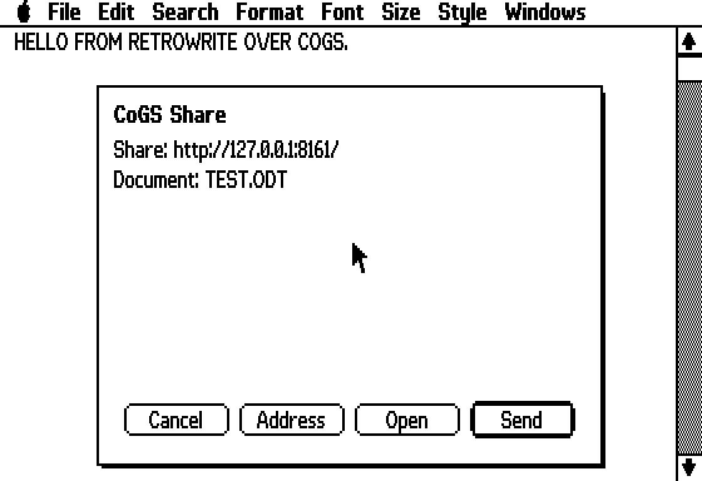
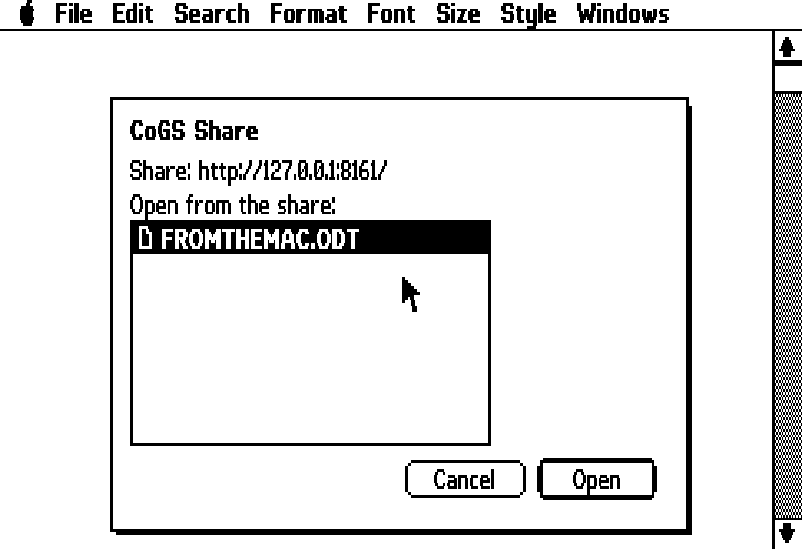

# RetroWrite II

A mouse-driven word processor for the **enhanced Apple IIe** (128K) under
ProDOS 8, in the spirit of MacWrite, MultiScribe and MouseWrite. It draws in
double hi-res (560×192) with its own fonts, and is designed for a hard disk.

**Version 2.2** · [Download (Releases)](https://github.com/6502retro/RetroWRITE/releases/latest) · [Owner's Manual (PDF)](docs/RetroWrite%20II%20Owner's%20Manual.pdf)

**New in 2.2: ODT documents.** RetroWrite II saves and opens `.ODT` files, the
OpenDocument format of LibreOffice and OpenOffice, which Word, Google Docs and
Pages also open. Write on the Apple IIe, copy the file to a modern computer and
double-click it, or bring documents back the other way.

## Features

- Pull-down menus driven by the mouse or by Open-Apple keys
- Three original fonts (Sans, Serif, Mono) in 9, 18 and 27 point
- Bold, italic, underline, superscript and subscript
- A ruler for margins, tab stops, alignment (left, center, right, justify) and line spacing
- Printing to an ImageWriter II, an Epson-compatible or a plain-text printer, in graphics ("as on screen") or the printer's own font
- Headers, footers, page numbers and page breaks; Print Several
- Find, Find Next and Replace
- A spelling checker with a 128,000-word dictionary, suggestions and a user dictionary
- A glossary (Control-G and a letter inserts stored text)
- Up to four documents open at once
- Desk accessories: Startup Preferences, Load DOS 3.3 File, Communications (Super Serial Card terminal), and BASIC.SYSTEM (type `BYE` to come back)
- A Mouse Tutorial document
- Saves and opens ODT documents (LibreOffice, OpenOffice, Word): fonts, sizes, styles, alignment, spacing, tabs, margins, page breaks, header and footer carry across
- Opens and saves plain ProDOS text files as well as its own documents

| Menu | Items |
|---|---|
| Apple | About · Keyboard Help · Mouse Tutorial · Startup Preferences · Load DOS 3.3 File · Communications · BASIC.SYSTEM |
| File | New · Open · Close · Save · Save As · Save As Text · Page Setup · Print · Print Several · Quit |
| Edit | Cut · Copy · Paste · Clear · Select All · Glossary · Edit Glossary |
| Search | Find · Find Next · Replace · Check Spelling · Edit User Dictionary |
| Format | Show Ruler · Align Left / Center / Align Right / Justify · Single, 1½ or Double Space · Insert Page Break |
| Font | Sans · Serif · Mono |
| Size | 9 · 18 · 27 point |
| Style | Plain Text · Bold · Italic · Underline · Superscript · Subscript |
| Windows | Up to four open documents |

## Requirements

- An enhanced Apple IIe (65C02) with 128K (an extended 80-column card)
- A mouse
- A hard disk (or large disk image) with ProDOS 8; RetroWrite II takes about 600K including its dictionary
- Optional: an ImageWriter II or Epson-compatible printer; a Super Serial Card for Communications

## Installing

The ready-to-use files are in [`prebuilt/`](prebuilt), and as one zip with the installer and the manual on the [Releases page](https://github.com/6502retro/RetroWRITE/releases/latest). Copy them into one
folder (for example `/HD/RETROWRITE`) on your ProDOS disk with these types:

| File | ProDOS type | Aux type |
|---|---|---|
| RW2.SYSTEM | SYS ($FF) | $2000 |
| RW2.MAIN | BIN ($06) | $4000 |
| RW2.LC | BIN | $D400 |
| RW2.FONTS, RW2.OVL1 – RW2.OVL9, RW2.OVLA – RW2.OVLC, RW2.SPLASH, SPELL.DICT | BIN | $0000 |
| TUTORIAL, LETTER | $50 (GWP) | $5257 |
| GLOSSARY | TXT ($04) | $0000 |

Then run `RW2.SYSTEM`. Copy `BASIC.SYSTEM` into the same folder if you want the
Apple → BASIC.SYSTEM accessory.

### With the installer (on a PC or Mac)

`install/install_rw2.py` writes all the files into a ProDOS disk image, sets the
file types, copies BASIC.SYSTEM from elsewhere on the disk if there is one,
and adds RetroWrite II to Apple II DeskTop's Shortcuts menu. It needs Python 3,
Java and [AppleCommander](https://applecommander.github.io/)'s command-line
`ac.jar`:

    python3 install/install_rw2.py MYDISK.po --ac path/to/ac.jar --files prebuilt

Back up your disk image first.

## Building from source

You need [cc65](https://cc65.github.io) (2.19 or later) and Python 3:

    ./build.sh                     # or: CC65_BIN=/path/to/cc65/bin ./build.sh

This writes everything into `build/`; the result is byte-for-byte the same as `prebuilt/`.

| Folder | Contents |
|---|---|
| `src/` | The program: C and 65C02 assembly for cc65. `main.c` and `core.c` stay in memory; `ovl_*.c` are overlays loaded from disk when needed (files, spelling, editing, menus, printing, accessories, dialogs, and the ODT writer and reader: `ovl_odtout.c`/`ovl_odtzip.c` write the XML and the ZIP, `ovl_odtin.c` with `inflate.s` unpacks, `ovl_odtrd.c` reads the XML). `gfx.s` draws text and graphics in double hi-res. |
| `loader/` | `RW2.SYSTEM`: checks the machine, shows the splash picture and loads the program |
| `art/` | The fonts (`font_*.py`, compiled by `mkfonts.py`), splash picture, tutorial and sample-document generators |
| `install/` | The disk-image installer |
| `man/` | The manual: `manual.md` is the text, `build.py` typesets it (Playwright, markdown, pypdf, pdfplumber, reportlab) in the same design as the RetroDB and RetroCALC manuals; `figs/` are the screen pictures |
| `docs/` | The Owner's Manual as a PDF |

To rebuild the manual: `python3 man/build.py "docs/RetroWrite II Owner's Manual.pdf"`.

## ODT support, in brief

- **Saving:** Save As adds `.ODT` to a name without a period; a name with another ending (such as `LETTER.RW`) saves RetroWrite II's own format. The ODT is a ZIP with its parts stored (no compression), written with CRC-32 by 6502 code. Fonts become Liberation Sans/Serif/Mono and the 9/18/27 point sizes become 12/24/36 point, which keeps lines about as long as RetroWrite II prints them.
- **Opening:** the Open dialog lists names ending in `.ODT` whatever their ProDOS type. A 6502 DEFLATE decoder unpacks `styles.xml` and `content.xml` into work files, using aux memory $4000-$BFFF as its 32K window, then a streaming XML reader builds the document. Text beyond ASCII is mapped to the nearest plain letters; pictures, footnotes and comments are left out.
- **Speed:** about half a minute for a short letter saved by LibreOffice on a 1 MHz IIe; files RetroWrite II saved itself open faster.

## CoGS Share (this fork)

With a [CoGS](https://a2cogs.com) card in the IIe or IIgs, the Apple menu has
a **CoGS Share...** item. It moves `.ODT` documents between the ProDOS disk
and the `files` folder of a CoGS share on your LAN (CoGS Image Manager on a
Mac, or `cogs_share.py --writable`), so a document written here shows up as
an ordinary file a modern computer opens straight away, and one saved by
LibreOffice can be opened here without copying it onto a disk image.

- **Send** uploads the document as last saved (Save or Save As first). The
  file keeps its ProDOS name, `LETTER.ODT`.
- **Open** lists the `.ODT` files in the share's `files` folder (long names
  get a ProDOS alias, `From The Mac.odt` is `FROMTHEMAC.ODT`), downloads
  the one you pick into your documents folder and opens it.
- **Address** sets the share's URL, `http://host:port/`, as Image Manager or
  `cogs_share.py` prints it. It is kept in `RW2.COGS` next to the program;
  the first time, the card's Image Source is offered as the default when it
  is a LAN share.

The card does the networking. The overlay (`src/ovl_net.c`, `src/net.s`,
`RW2.OVLC`) talks to the card through its slot registers, one HTTP command
frame per request; a document goes up in 1 KB pieces with a `Content-Range`
header the share joins. Firmware 1.39 or later on the card. The `files`
endpoint is in `cogs_share.py` now and is coming to Image Manager.

## Document format

RetroWrite II documents are ProDOS type $50 with aux type $5257 ("RW"). The
manual's Appendix E describes the format: a 105-byte header (`RW2D`, version,
margins, tab stops, header and footer) followed by ASCII text with format bytes
($80 + font, size and style bits) and paragraph marks.

## Notes

- Tested in the [apple2js](https://github.com/whscullin/apple2js) emulator, including printing (captured from the printer port). It has not yet been run on real hardware — reports are welcome.
- On a stock 1 MHz IIe typing takes about a quarter of a second per character; type-ahead is never lost, and an accelerator helps a lot.
- The spelling dictionary was built from the English word list of [pyspellchecker](https://github.com/barrust/pyspellchecker) (MIT), plus Apple II words.

## Licence

MIT — see [LICENSE](LICENSE). The manual's fonts (EB Garamond, Courier Prime) are under the SIL Open Font License (`man/fonts`). RetroWrite II is an independent program by
6502 Retro Computing. It is not a product of Apple or of the publishers of
MacWrite, MultiScribe or MouseWrite, and contains no code from them.

## Screenshots

